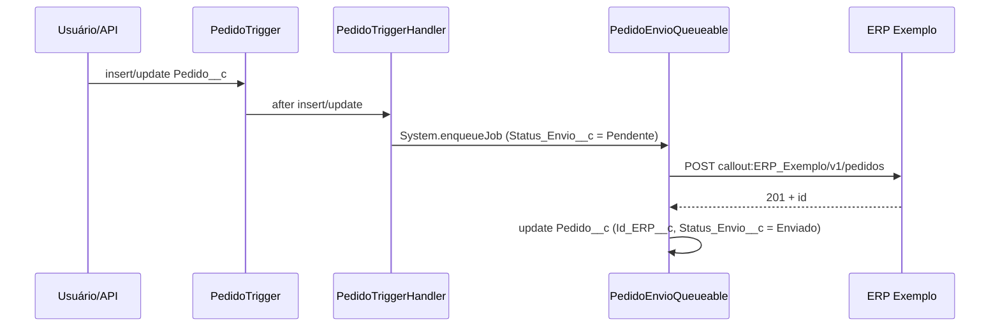

# EX01 — Envio de pedido ao ERP (FICTÍCIO)

> ⚠️ **Exemplo fictício.** Org `ORG-EXEMPLO`, sistema "ERP Exemplo", classes e hosts inventados.

## 1. Projeto encontrado

```
objects/Pedido__c/Pedido__c.object
objects/Pedido__c/fields/Status_Envio__c.field          (picklist: Pendente, Enviado, Erro)
objects/Pedido__c/fields/Id_ERP__c.field                (externalId = true)
objects/Integracao_Config__mdt/Integracao_Config__mdt.object
objects/Integracao_Config__mdt/fields/Named_Credential__c.field
objects/Integracao_Config__mdt/fields/Path__c.field
objects/Integracao_Config__mdt/fields/Ativo__c.field
customMetadata/Integracao_Config.ERP_Pedido.md          (Named_Credential__c = ERP_Exemplo; Path__c = /v1/pedidos; Ativo__c = true)
triggers/PedidoTrigger.trigger                          (after insert, after update on Pedido__c)
classes/PedidoTriggerHandler.cls
classes/PedidoEnvioQueueable.cls                        (implements Queueable, Database.AllowsCallouts)
classes/PedidoEnvioQueueableTest.cls                    (HttpCalloutMock)
namedCredentials/ERP_Exemplo.namedCredential            (namedCredentialType = SecuredEndpoint; Url = https://api.erp-exemplo.example; Authentication → ERP_Exemplo_Auth)
externalCredentials/ERP_Exemplo_Auth.externalCredential (authenticationProtocol = Oauth; NamedPrincipal)
permissionsets/Integracao_ERP.permissionset             (externalCredentialPrincipalAccesses: ERP_Exemplo_Auth-Principal)
```

## 2. Diagnóstico

| Passo | Resultado | Base |
|---|---|---|
| Sinais | S07: `PedidoEnvioQueueable` com `implements Queueable, Database.AllowsCallouts` (C07), enfileirado pelo handler do trigger (L40) | diagnostico.md |
| Teste descartado | `PedidoEnvioQueueableTest.cls` só tem `HttpCalloutMock` (S37 / C23) | guia_evidencias.md |
| Endpoint | o código monta `'callout:' + cfg.Named_Credential__c + cfg.Path__c` → valor vem do registro `Integracao_Config.ERP_Pedido` (L37, L36) → `ERP_Exemplo` (L01) → `ERP_Exemplo_Auth` (L02) → Permission Set (L07) | regras_ligacao.md |
| Variante | endpoint E5 (Custom Metadata guarda o nome da Named Credential) + Queueable = **D.1.v11** | out-async.md |
| Assinatura mínima de D.1 | `CustomObject`, `ApexTrigger`, `ApexClass` presentes | diagnostico.md §2 |
| Confiança | **ALTA** (todas as ligações são "documentado", exceto L36/L37, heurísticas confirmadas pelo registro literal) | — |

## 3. Documento final (formato B do template)

# ORG-EXEMPLO — Envio de pedido ao ERP

> Org: ORG-EXEMPLO · Status: NÃO VALIDADO — EXEMPLO · Confiança: ALTA · Etapas inferidas: 0 de 5

### 1. Resumo
Quando um pedido é criado ou alterado, o Salesforce envia os dados ao ERP em segundo plano. O usuário não espera a resposta. O ERP devolve o seu identificador do pedido, que fica gravado no Salesforce.

### 2. Ficha rápida
| Item | Valor |
|---|---|
| Direção | OUTBOUND |
| Sistema externo | ERP Exemplo (`api.erp-exemplo.example`) |
| Mecanismo | REST |
| Execução | Assíncrona (Queueable) |
| Posição na jornada | 1 de 1 |

### 3. Fluxo


| # | O que acontece | Componente | Sync/Async | Confiança |
|---|---|---|---|---|
| 1 | Pedido gravado dispara o trigger | `PedidoTrigger` | Sync | ALTA |
| 2 | Handler seleciona pedidos pendentes e enfileira o envio | `PedidoTriggerHandler` | Sync | ALTA |
| 3 | Lê a configuração da integração | `Integracao_Config.ERP_Pedido` | Async | ALTA |
| 4 | Chama o ERP | `PedidoEnvioQueueable` → `ERP_Exemplo` | Async | ALTA |
| 5 | Grava o retorno no pedido | `PedidoEnvioQueueable` | Async | ALTA |

### 4. Gatilhos de integração
| Gatilho | Tipo | Componente | Condição |
|---|---|---|---|
| Criação/alteração de pedido | trigger | `PedidoTrigger` | `Status_Envio__c` = Pendente e `Ativo__c` = true |

### 5. Objetos
| Objeto | Campos principais | Leitura/Escrita | Observação |
|---|---|---|---|
| `Pedido__c` | `Status_Envio__c`, `Id_ERP__c` | L/E | `Id_ERP__c` é External ID; `Status_Envio__c` é campo de controle |

### 6. Classes
| Classe | Papel na integração | Tipo |
|---|---|---|
| `PedidoTriggerHandler` | filtra e enfileira | handler |
| `PedidoEnvioQueueable` | callout e writeback | queueable |

### 7. Componentes de integração
| Tipo | Nome | Host | Autenticação | Certificado | Vencimento |
|---|---|---|---|---|---|
| Named Credential (SecuredEndpoint) | `ERP_Exemplo` | `api.erp-exemplo.example` | via `ERP_Exemplo_Auth` | Não informado | Não informado |
| External Credential | `ERP_Exemplo_Auth` | — | OAuth, principal nomeado | — | — |

### 8. Custom Metadata
| Tipo (__mdt) | Registro | Finalidade | Campos relevantes |
|---|---|---|---|
| `Integracao_Config__mdt` | `ERP_Pedido` | aponta a Named Credential e o path; liga/desliga | `Named_Credential__c` = ERP_Exemplo; `Path__c` = /v1/pedidos; `Ativo__c` = true |

### 9. Flows
Não se aplica a esta integração.

### 10. LWC
Não se aplica a esta integração.

### 11. Profiles e Permission Sets
| Profile / Permission Set | Acesso concedido | Usuário de integração? |
|---|---|---|
| `Integracao_ERP` | principal de `ERP_Exemplo_Auth` | Não informado (atribuição não está no repositório — N04) |

### 12. Tratamento de erros e reprocessamento
Em erro HTTP, a classe grava `Status_Envio__c` = Erro. Não há Finalizer nem reenvio automático.

### 13. Pontos em aberto
- **A09** (sem retry): pedidos com erro dependem de ação manual.
- **A11** (sem log): não há objeto de log nem ID de correlação.
- **A13** (writeback): o update do pedido dispara o trigger de novo; a guarda é `Status_Envio__c` ≠ Pendente — confirmar que cobre todos os caminhos.
- **Limites:** um Queueable por transação síncrona do trigger pode enfileirar até 50 jobs; em carga de dados com muitos lotes, o limite diário de execuções assíncronas também conta.
- **Não informado:** usuário que executa o job e volumetria (N04, N13).

### Apêndice — Rastreabilidade
| Item | Evidência |
|---|---|
| Enfileiramento | `classes/PedidoTriggerHandler.cls:18` |
| Callout | `classes/PedidoEnvioQueueable.cls:24` (`setEndpoint('callout:' + ...)`) |
| Configuração | `customMetadata/Integracao_Config.ERP_Pedido.md:5-12` |
| Autenticação | `namedCredentials/ERP_Exemplo.namedCredential:7` |
