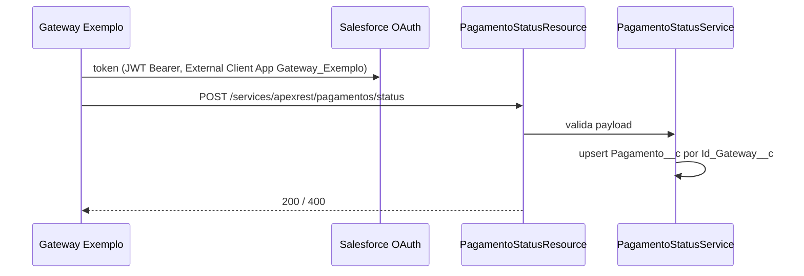

# EX02 — Recebimento de status de pagamento (FICTÍCIO)

> ⚠️ **Exemplo fictício.** Org `ORG-EXEMPLO`, sistema "Gateway Exemplo", classes e nomes inventados.

## 1. Projeto encontrado

```
classes/PagamentoStatusResource.cls        (@RestResource(urlMapping='/pagamentos/status/*'), @HttpPost)
classes/PagamentoStatusService.cls
objects/Pagamento__c/fields/Id_Gateway__c.field   (externalId = true)
objects/Pagamento__c/fields/Status__c.field
externalClientApps/Gateway_Exemplo.eca
extlClntAppOauthSettings/Gateway_Exemplo_oauth.ecaOauth           (commaSeparatedOauthScopes = Api)
extlClntAppGlobalOauthSettings/Gateway_Exemplo_glbloauth.ecaGlblOauth  (certificate = <PEM>; consumerSecret ausente)
extlClntAppOauthPolicies/Gateway_Exemplo_plcy.ecaOauthPlcy        (commaSeparatedPermissionSet = Integracao_Gateway)
extlClntAppPolicies/Gateway_Exemplo_plcy.ecaPlcy
permissionsets/Integracao_Gateway.permissionset   (classAccesses: PagamentoStatusResource; objectPermissions: Pagamento__c)
```

## 2. Diagnóstico

| Passo | Resultado | Base |
|---|---|---|
| Sinais | S01 (`@RestResource`, C11); S04 + certificado no `.ecaGlblOauth` → fluxo JWT Bearer (guia, seção 4) | diagnostico.md, guia_evidencias.md |
| Cadeia | ECA (L29) → Permission Set via `commaSeparatedPermissionSet` (L30) → `classAccesses` da classe REST (L33) → `PagamentoStatusService` (L38) → upsert em `Pagamento__c` por `Id_Gateway__c` | regras_ligacao.md |
| Variante | External Client App + JWT Bearer + Apex REST = **g.3.v5** | in-sync.md |
| Confiança | **ALTA** para o lado Salesforce; o cliente que chama não aparece no repositório (N10) | limites_da_fonte.md |

## 3. Documento final (formato B do template)

# ORG-EXEMPLO — Recebimento de status de pagamento

> Org: ORG-EXEMPLO · Status: NÃO VALIDADO — EXEMPLO · Confiança: ALTA · Etapas inferidas: 1 de 4

### 1. Resumo
O gateway de pagamento avisa o Salesforce quando um pagamento muda de status. O Salesforce localiza o pagamento pelo identificador do gateway e atualiza o status na hora, respondendo ao gateway.

### 2. Ficha rápida
| Item | Valor |
|---|---|
| Direção | INBOUND |
| Sistema externo | Gateway Exemplo |
| Mecanismo | REST (Apex REST `/services/apexrest/pagamentos/status/*`) |
| Execução | Síncrona |
| Posição na jornada | 1 de 1 |

### 3. Fluxo


| # | O que acontece | Componente | Sync/Async | Confiança |
|---|---|---|---|---|
| 1 | Gateway obtém token | `Gateway_Exemplo` (ECA) | Sync | MEDIA [INFERIDO: fluxo JWT pelo certificado] |
| 2 | Gateway chama o endpoint | `PagamentoStatusResource` | Sync | ALTA |
| 3 | Valida e aplica a regra | `PagamentoStatusService` | Sync | ALTA |
| 4 | Atualiza o pagamento | `Pagamento__c` | Sync | ALTA |

### 4. Gatilhos de integração
| Gatilho | Tipo | Componente | Condição |
|---|---|---|---|
| Mudança de status no gateway | chamada externa | `PagamentoStatusResource` | `@HttpPost` |

### 5. Objetos
| Objeto | Campos principais | Leitura/Escrita | Observação |
|---|---|---|---|
| `Pagamento__c` | `Id_Gateway__c`, `Status__c` | L/E | `Id_Gateway__c` é External ID (chave do upsert) |

### 6. Classes
| Classe | Papel na integração | Tipo |
|---|---|---|
| `PagamentoStatusResource` | endpoint de entrada | REST resource |
| `PagamentoStatusService` | validação e upsert | serviço |

### 7. Componentes de integração
| Tipo | Nome | Host | Autenticação | Certificado | Vencimento |
|---|---|---|---|---|---|
| External Client App | `Gateway_Exemplo` | — | OAuth 2.0 JWT Bearer [INFERIDO] | sim (no app) | Não informado |

### 8. Custom Metadata
Não identificado na base analisada.

### 9. Flows
Não identificado na base analisada.

### 10. LWC
Não se aplica a esta integração.

### 11. Profiles e Permission Sets
| Profile / Permission Set | Acesso concedido | Usuário de integração? |
|---|---|---|
| `Integracao_Gateway` | classe `PagamentoStatusResource`; objeto `Pagamento__c` | sim (pré-autorizado no ECA); nome do usuário Não informado (N05) |

### 12. Tratamento de erros e reprocessamento
Payload inválido → resposta 400 com mensagem. Não há fila: o reenvio depende do gateway.

### 13. Pontos em aberto
- Fluxo OAuth inferido pelo certificado; confirmar com o time do gateway (N11).
- Volume de chamadas e consumo do limite diário de API: Não informado (N13; limites_plataforma: "Requisições de API em 24 h").
- Chamadas que duram 20 s ou mais contam no limite de 25 concorrentes (limites_plataforma).

### Apêndice — Rastreabilidade
| Item | Evidência |
|---|---|
| Endpoint | `classes/PagamentoStatusResource.cls:1-3` |
| Upsert | `classes/PagamentoStatusService.cls:30` |
| Pré-autorização | `extlClntAppOauthPolicies/Gateway_Exemplo_plcy.ecaOauthPlcy:6` |
