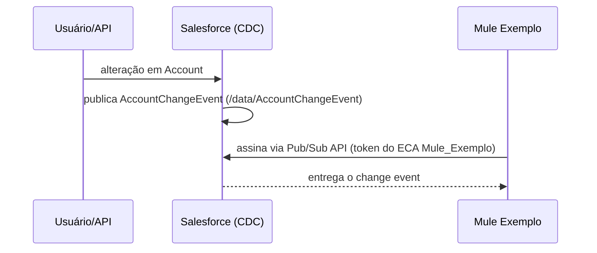

# EX03 — Sincronização de clientes via middleware (FICTÍCIO)

> ⚠️ **Exemplo fictício.** Org `ORG-EXEMPLO`, middleware "Mule Exemplo", nomes inventados.

## 1. Projeto encontrado

```
platformEventChannelMembers/ChangeEvents_AccountChangeEvent.platformEventChannelMember   (eventChannel = ChangeEvents; selectedEntity = AccountChangeEvent)
externalClientApps/Mule_Exemplo.eca
extlClntAppOauthSettings/Mule_Exemplo_oauth.ecaOauth
extlClntAppGlobalOauthSettings/Mule_Exemplo_glbloauth.ecaGlblOauth   (certificate = <PEM>)
extlClntAppOauthPolicies/Mule_Exemplo_plcy.ecaOauthPlcy             (commaSeparatedPermissionSet = Integracao_Mule)
extlClntAppPolicies/Mule_Exemplo_plcy.ecaPlcy
permissionsets/Integracao_Mule.permissionset                        (objectPermissions: Account read)
```

Não há trigger em `AccountChangeEvent`, nem `ManagedEventSubscription`.

## 2. Diagnóstico

| Passo | Resultado | Base |
|---|---|---|
| Sinais | S21 (`PlatformEventChannelMember` em ChangeEvents, sem trigger C21) → assinante externo; S04 (ECA com certificado) | diagnostico.md |
| Cadeia | channel member (L18) → `AccountChangeEvent`; ECA (L29) → `Integracao_Mule` (L30) | regras_ligacao.md |
| Desambiguação | E.2 (assinante externo genérico) × M.2 (middleware): o nome do app e a informação do time indicam o MuleSoft → **M.2.v4** | mid.md |
| Confiança | **MEDIA**: o assinante externo não aparece no repositório (N08); a ligação ECA ↔ CDC é presumida | limites_da_fonte.md |

## 3. Documento final (formato B do template)

# ORG-EXEMPLO — Sincronização de clientes via middleware

> Org: ORG-EXEMPLO · Status: NÃO VALIDADO — EXEMPLO · Confiança: MEDIA · Etapas inferidas: 2 de 3

### 1. Resumo
Toda alteração em contas gera um evento de mudança no Salesforce. O middleware assina esses eventos e repassa as mudanças aos sistemas internos. O Salesforce não espera retorno.

### 2. Ficha rápida
| Item | Valor |
|---|---|
| Direção | OUTBOUND (evento) |
| Sistema externo | Mule Exemplo (middleware) |
| Mecanismo | Change Data Capture via Pub/Sub API |
| Execução | Assíncrona |
| Posição na jornada | 1 de 1 |

### 3. Fluxo


| # | O que acontece | Componente | Sync/Async | Confiança |
|---|---|---|---|---|
| 1 | Alteração em conta gera change event | `ChangeEvents_AccountChangeEvent` | Async | ALTA |
| 2 | Middleware autentica | `Mule_Exemplo` (ECA) | — | MEDIA [INFERIDO] |
| 3 | Middleware recebe e repassa | Mule Exemplo | Async | BAIXA [INFERIDO: fora do repositório] |

### 4. Gatilhos de integração
| Gatilho | Tipo | Componente | Condição |
|---|---|---|---|
| Criação, alteração, exclusão ou undelete de Account | Platform Event (change event) | `ChangeEvents_AccountChangeEvent` | todas as mudanças (sem `filterExpression`) |

### 5. Objetos
| Objeto | Campos principais | Leitura/Escrita | Observação |
|---|---|---|---|
| `Account` | todos os campos alterados | L | sem campos de enriquecimento |

### 6. Classes
Não identificado na base analisada.

### 7. Componentes de integração
| Tipo | Nome | Host | Autenticação | Certificado | Vencimento |
|---|---|---|---|---|---|
| External Client App | `Mule_Exemplo` | — | JWT Bearer [INFERIDO] | sim (no app) | Não informado |

### 8. Custom Metadata
Não identificado na base analisada.

### 9. Flows
Não identificado na base analisada.

### 10. LWC
Não se aplica a esta integração.

### 11. Profiles e Permission Sets
| Profile / Permission Set | Acesso concedido | Usuário de integração? |
|---|---|---|
| `Integracao_Mule` | leitura de Account | sim (pré-autorizado no ECA); nome Não informado |

### 12. Tratamento de erros e reprocessamento
Do lado Salesforce não há tratamento: a recuperação depende do replay do assinante no middleware (fora do repositório).

### 13. Pontos em aberto
- Confirmar com o time que o assinante é o Mule Exemplo (N08).
- **Limites:** entrega de eventos a clientes de API conta na alocação diária (50.000 / 25.000 / 10.000 conforme a edição, sem add-on) e o CDC aceita 5 entidades selecionadas sem add-on (limites_plataforma).
- Mensagens acima de 1 MB viram gap events: avaliar se Account tem muitos campos longos.
- **A04:** confirmar que `Mule_Exemplo` é usado só por esta integração.

### Apêndice — Rastreabilidade
| Item | Evidência |
|---|---|
| Seleção do CDC | `platformEventChannelMembers/ChangeEvents_AccountChangeEvent.platformEventChannelMember:3-4` |
| App de entrada | `externalClientApps/Mule_Exemplo.eca:1` |
| Permissão | `permissionsets/Integracao_Mule.permissionset:10` |
